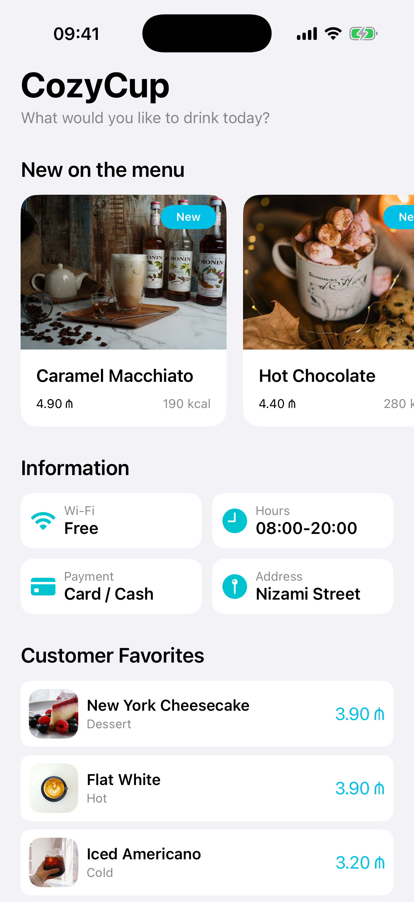
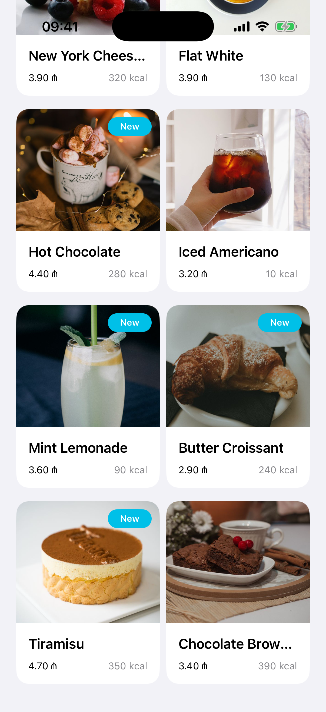

# coffee

**CozyCup** is a SwiftUI coffee shop app: a home screen with new menu items, shop information, customer favorites and the full menu.

## Screenshots

| Home | Full menu |
|:---:|:---:|
|  |  |

## Features

- **New on the menu** — horizontal carousel of new items with a "New" badge
- **Information** — Wi-Fi, opening hours, payment methods and address in a `Grid`
- **Customer Favorites** — list of popular items with category and price
- **Full Menu** — the whole menu in a two-column `LazyVGrid`
- Photos are loaded from the network with `AsyncImage`

## Project structure

```
coffee/
├── coffeeApp.swift
├── Screens/
│   └── HomeView.swift
├── Views/Components/
│   ├── NewMenuCardView.swift
│   ├── InformationCardView.swift
│   ├── CustomerFavoritesCardView.swift
│   ├── SectionTitleView.swift
│   └── CustomImageView.swift
└── MockData/
    └── CoffeeItem.swift
```

## Run

1. Open `coffee.xcodeproj` in Xcode
2. Pick an iPhone simulator and press **Run** (⌘R)

## Tech stack

Swift · SwiftUI · Xcode
